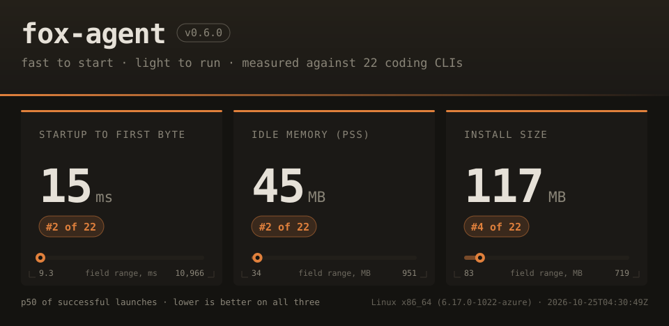
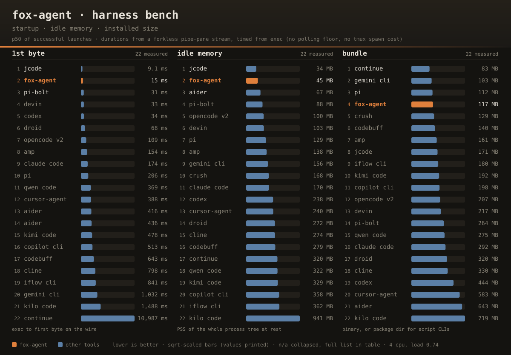

# fox-agent

[](https://github.com/QQSHI13/fox-agent/actions/workflows/ci.yml)
[](https://github.com/QQSHI13/fox-agent/actions/workflows/bench.yml)
[](https://github.com/QQSHI13/fox-agent/releases)
[](LICENSE)
[](https://bun.sh)

A light coding harness with **agent-controlled context** -- the agent edits its own context window natively (`ctx_edit`), no host hacks.

Full machine control, zero permission prompts. Production turn loop with step caps, retry/backoff, parallel tool execution, abort-safe partial persistence, and auto-compaction near the context limit. SQLite event-sourced sessions. OpenAI-compatible gateway first plus native Anthropic and Google providers. TUI and headless modes. ACP both ways. Plugin system.

```bash
curl -fsSL https://github.com/QQSHI13/fox-agent/raw/main/install.sh | bash   # -> /usr/local/bin/fox
fox
```

No key? The TUI opens anyway and `/login` walks you through provider setup.

---

## Performance

<!-- bench:start -->


fox-agent headless vs scripted local provider: time to first token **39 ms**, peak RSS **61 MB**.

<details><summary>the full field · every tool, every metric</summary>



</details>

<details><summary>full precision · min/p50/p95 per metric</summary>

| agent | version | 1st byte min/p50/p95 (ms) | idle PSS (MB) | bundle (MB) | kind | `--version` min/p50/p95 (ms) | n |
|---|---|---|---|---|---|---|---|
| **fox-agent** | 0.7.0 | 17.4/18.3/18.9 | 47.3 | 116.9 | bin | 5.6/6.2/7.0 | 5 |
| claude code | 2.1.312 (Claude Code) | 165.2/170.8/184.2 | 181.5 | 293.6 | bin | 8.5/10.5/11.6 | 5 |
| codex | codex-cli 0.165.0 | 31.9/32.8/34.6 | 163.8 | 446.0 | pkg | 32.9/33.5/35.6 | 5 |
| jcode | jcode v0.99.1 (7206efd0c) | 8.9/9.3/65.6 | 37.5 | 171.3 | bin | 7.9/8.2/9.1 | 5 |
| pi | 1.4.0 | 199.7/206.9/219.4 | 130.9 | 112.2 | pkg | 163.1/169.3/169.4 | 5 |
| pi-bolt | 1.4.0 (Pi-Bolt 1.0.7, linux-x64, JIT off) | 24.2/24.8/28.2 | 73.8 | 256.9 | bin | 8.0/9.0/9.1 | 5 |
| gemini cli | 0.66.0 | 1013.0/1024.9/1091.0 | 145.3 | 102.7 | pkg | 941.5/957.7/1025.5 | 5 |
| copilot cli | GitHub Copilot CLI 1.0.105. | 476.5/540.4/659.5 | 371.9 | 198.6 | pkg | 73.4/77.5/78.9 | 5 |
| crush | crush version v0.98.2 | 381.3/405.9/710.3 | 148.0 | 128.9 | pkg | 87.0/94.5/112.1 | 5 |
| aider | aider 0.86.2 | 429.3/438.5/480.4 | 68.2 | 642.8 | pkg | 504.4/522.4/529.3 | 5 |
| amp | 0.0.1793174452-gd75e9a (released 2026-10-28T08:00:52.000Z, 1 | 152.2/157.2/170.0 | 139.8 | 161.3 | bin | 150.8/158.7/164.4 | 5 |
| cursor-agent | 2026.10.22-27dcf5f | 278.5/411.0/475.8 | 233.8 | 583.2 | pkg | 319.5/351.8/352.7 | 5 |
| qwen code | 0.26.2 | 366.9/370.4/603.6 | 321.7 | 290.9 | pkg | 31.1/32.4/35.7 | 5 |
| codebuff | 1.0.688 | 682.0/738.2/796.4 | 277.1 | 140.0 | bin | 683.1/699.4/700.5 | 5 |
| kilo code | 7.8.18 | 1428.6/1469.7/1616.1 | 929.0 | 720.0 | pkg | 592.7/610.9/674.0 | 5 |
| droid | 0.251.0 | 65.9/72.3/73.5 | 282.7 | 324.0 | bin | 59.5/61.1/72.8 | 5 |
| kimi code | 2.3.3 | 493.1/503.5/526.0 | 332.1 | 192.4 | bin | 381.4/396.4/404.2 | 5 |
| devin | devin 3000.11.228 (053434014dbd) | 18.1/39.3/42.7 | 75.3 | 217.5 | bin | 4.4/5.6/5.6 | 5 |
| cline | 3.0.74 | 775.1/787.8/1023.3 | 261.7 | 345.8 | pkg | 636.9/657.5/700.8 | 5 |
| continue | 1.5.47 | 10996.7/11007.0/11010.1 | 317.2 | 82.7 | pkg | 735.8/761.9/774.0 | 5 |
| iflow cli | 0.5.19 | 831.4/840.4/851.2 | 359.3 | 180.3 | pkg | 781.1/813.7/827.4 | 5 |
| opencode v2 | opencode2 v0.0.0-beta-19271 | 91.7/105.3/105.6 | 98.7 | 207.4 | bin | 58.4/60.6/100.6 | 5 |

</details>

_Generated 2026-10-28T09:43:14Z on Linux x86_64 (7.0.0-1017-azure), load 1.19 on 4 cpu. [Method and caveats](#benchmarks) · [raw JSON](bench/results.json)_
<!-- bench:end -->

---

## Quick Start

**Prebuilt binary (recommended)** -- Linux and macOS, x64 and arm64:

```bash
curl -fsSL https://github.com/QQSHI13/fox-agent/raw/main/install.sh | bash
```

Binaries self-update with `fox upgrade` (`--beta` for prereleases, `fox upgrade <version>` to pin); downloads are SHA-256 verified and the previous binary is kept as `.fox-previous`.

**From source** (requires [Bun](https://bun.sh) >= 1.4.0):

```bash
git clone https://github.com/QQSHI13/fox-agent.git
cd fox-agent
bun install && bun run build      # -> bin/fox
```

More: [install options](docs/getting-started/install.md) · [quickstart](docs/getting-started/quickstart.md).

## Usage

```bash
fox                                              # TUI
fox -p "summarize this repo's layout"            # one-shot answer
fox json -p "..."                                # NDJSON agent events
fox mini                                         # plain streaming REPL, no TUI
fox -c                                           # resume latest session
fox acp                                          # serve ACP on stdio
```

`fox -c <n>` indexes the same list `fox ls` prints (most recently worked-in
first, across all directories), resolved through one shared resolver so a
listing and the resume it feeds cannot disagree. The index is a *position*, so
it shifts as you work elsewhere -- script against the id instead: `fox -c <id>`.
The interactive picker (`fox -c` with no argument) lists only *this directory*
by default; press `a` there to widen to all directories.

## Features

- **Tools**: read/write/edit (whitespace-tolerant patch engine)/glob/grep (ripgrep when present)/exec (process-group kill)/pty (tmux, resize-proof)/repl (in-process JS scratchpad)/ctx (search/stats/hide/rewrite your own context)/todo/task (delegation over ACP or A2A)/fetch/MCP client. `read` attaches images, audio and video as media when the active model accepts them.
- **ACP both ways**: `fox --acp` serves the protocol to Zed/acpx; fox also drives other ACP agents as a client (what `task` is built on). Agents configured with a `url` are reached over **A2A**.
- **Plugins**: one module adds tools, lifecycle hooks and custom providers. Global config only.
- **200+ providers** via the models.dev catalog -- `/login` presets prefill endpoint, env var and model lists. Any OpenAI-compatible/Responses, Anthropic or Gemini endpoint works too.
- **Steering mid-turn**: queue messages (stacked above the input; ctrl+up withdraws the last) or ctrl+s to inject after the current tool finishes.
- **TUI on a custom ANSI renderer**: streaming markdown, inline `[N]` message markers, slash commands, `!` shell mode, esc interrupt, mouse selection, themes.
- **Headless**: `-p`, `fox json`, stdin piping, `fox mini`, plus a library API (`createAgent`).
- **SQLite event-sourced sessions**: one database per session; append-only log + view ops + refs, so reverts and forks are queries rather than rewrites.
- **Production turn loop**: step caps, retry/backoff on 429/5xx, parallel tool execution, abort-safe partial persistence, auto-compaction.

---

## Benchmarks

The [Performance](#performance) block is generated by the [`bench` workflow](https://github.com/QQSHI13/fox-agent/actions/workflows/bench.yml) (weekly, on every push, and on demand) and committed to [`bench/`](bench/), so what you see is the latest run rather than numbers typed by hand. Raw data: [`bench/results.json`](bench/results.json).

The block at the top is one image: fox-agent's three numbers, each with its rank in the field. Below it, two folded blocks -- the full field as a dashboard, and the full-precision record with min/p50/p95 per tool.

What each metric means:

- **1st byte**: the binary started in a pty with no arguments, timed from `exec` to the first byte it writes. This is the harness's own cost, not the model's. It is measured because several tools short-circuit `--version` before loading their bundle, so `--version` flatters them while first byte does not.
- **Idle memory (PSS)**: resident cost of the whole process tree at rest, before any model traffic. It counts children, because a node-based CLI runs its UI in a worker and charging only the launcher understates it by 2-8x. PSS divides shared pages rather than double-counting them. The practical claim is *how many agents you can run in one container*.
- **Install size**: full on-disk footprint -- the binary for native executables (following launcher wrappers to the binary they hand off to, including wrappers that compute that target at runtime from a version file), the package directory for script CLIs (weighing only a 2 KB loader shim would pretend node and node_modules are free).
- **Time to first token** (fox-agent only, above): spawn to first text event of a headless `fox -p … --json` turn against the repo's scripted local provider -- no key, no network. Competitors need real credentials for a turn, so there is no honest cross-tool TTFT.

Reading the numbers honestly:

- These measure the *harness*, not the model -- turn latency is dominated by your provider, and every tool here talks to the same APIs.
- **Published numbers are p50, with min and p95 beside them in `bench/table.md`.** Best-of-N alone is not enough: a single lucky launch is not the typical experience, and the spread is often the story (one release of `opencode` measured 101 ms at its best and 1539 ms at p95).
- **A timeout is never a measurement.** A run that never produces output is recorded as a failure, excluded from the statistics, and listed under "what could not be measured" -- it is not published as a slow time and it is not ranked.
- A tool not installed on the bench machine is an `n/a` row, never an estimate, and is excluded from rank counts rather than ranked last. A row with fewer than three successful launches is reported but not ranked: one lucky launch is not a comparison.
- Ranks are "1 + how many tools were strictly faster", so ties share a rank.
- Durations come from a forkless byte stream (`tmux pipe-pane` into a FIFO), timed from `exec`. That matters more than it sounds: an earlier version polled `tmux capture-pane` once per sample, which forks tmux at 9-17 ms a go, so its numbers carried an undeclared ~22 ms floor -- and published a 4.2 ms latency, below the cost of a single observation.
- Numbers move with machine load -- `bench/results.json` records the load average and CPU count alongside the rows, because the same tool measured 2.9 s and 10.3 s for first byte on the same box under different load.

**Why only three.** Earlier versions also measured time-to-interactive and keystroke latency, by typing a probe into the running TUI. Both require the tool to accept a keystroke, so every tool that shows a trust prompt, a login screen or an error modal cannot be measured at all -- in the last full field run that was 14 of 22 tools, an honest column that was mostly `n/a`. A metric two thirds of the field cannot produce is not a comparison, so the metric was dropped rather than the caveat being published. The three that remain every CLI answers the same way, with no login and no keystroke.

Reproduce locally (measures whatever is on your `PATH`):

```bash
bun run bench                                                   # build + measure; writes bench/
python3 scripts/bench/bench.py --quick --out /tmp/bench         # 2 launches, for smoke tests
python3 scripts/bench/bench.py --only fox-agent,jcode --out /tmp/b   # a subset (needs --out)
python3 scripts/bench/bench.py --self-test                       # verify the rig itself
```

---

## Configuration

Cascade (later wins): defaults <- `~/.config/fox-agent/config.toml` <- project `fox-agent.toml` <- env (`FOX_AGENT_*`) <- CLI flags. TOML is the only format; a malformed file fails loudly, naming the file and the parser error.

`/settings` lists the scalar knobs with current values, `/settings key=value` changes one (validated, saved globally, applied live), `/settings key=` resets it.

```toml
model = "kimi-k2"
provider = "openrouter"   # a [providers.*] profile name, or a bare API format
maxSteps = 0              # turn step cap; 0 (default) = unlimited
compactAt = 0.85
retryLimit = 3

# Plugins load from the GLOBAL config only -- a plugin runs in fox-agent's own
# process with your credentials, so a project file cannot introduce one.
plugins = ["~/my-fox-plugin.ts"]

# Named provider profiles; apiKey/headers resolve "$ENV" and "!cmd".
[providers.openrouter]
format = "openai-compatible"
baseUrl = "https://openrouter.ai/api/v1"
apiKey = "$OPENROUTER_API_KEY"
defaultModel = "moonshotai/kimi-k2"

[mcpServers.fs]
command = "npx"
args = ["-y", "@modelcontextprotocol/server-fs", "/tmp"]

# Agents the `task` tool may delegate to.
[agents.reviewer]
command = "some-other-acp-agent"
args = ["--acp"]
```

Full reference: [configuration](docs/configuration/index.md) · [environment variables](docs/configuration/environment-variables.md) · [providers and profiles](docs/configuration/providers.md).

### Environment variables

| Variable | Description |
|---|---|
| `FOX_AGENT_MODEL` | Model to use |
| `FOX_AGENT_BASE_URL` | Provider base URL |
| `FOX_AGENT_API_KEY` | API key |
| `FOX_AGENT_PROVIDER` | `openai-compatible` / `openai-responses` / `anthropic` / `google` / plugin name |
| `FOX_AGENT_MAX_STEPS` | Turn step cap (0 = unlimited) |
| `FOX_AGENT_COMPACT_AT` | Context compaction threshold (fraction of the window) |
| `FOX_AGENT_RETRY_LIMIT` | Retry count on 429/5xx |
| `FOX_AGENT_REQUEST_TIMEOUT_MS` | Timeout without progress (default 120000, 0 disables) |
| `FOX_AGENT_HOME` | State dir (default `~/.local/share/fox-agent`) |

`OPENAI_*` / `ANTHROPIC_API_KEY` / `GEMINI_API_KEY` / `GOOGLE_API_KEY` are honored as fallbacks. Unknown keys and non-URL `baseUrl` values surface as warnings, not silent ignores.

`FOX_AGENT_REQUEST_TIMEOUT_MS` bounds **time without progress**, not total duration: the clock is rearmed on every streamed chunk, so a model that reasons for ten minutes is fine while one that goes quiet fails with a retriable error.

---

## Mouse and Selection

fox-agent takes button-event tracking, so it owns the mouse while it runs -- including drags.

- **click** a thinking block or tool output to fold/unfold (fires on *release*, so a misdrag never flips it).
- **drag** across the transcript to select; release copies. Wide characters come back whole.
- **ctrl+c** copies a live selection instead of interrupting; press again with nothing selected to abort the turn. **esc** clears it first.
- Copy tries `powershell.exe` (WSL, UTF-8-safe), `wl-copy`, `xclip`, `pbcopy`, then OSC 52 (works over SSH with no helper).
- Your terminal's native selection still works with the usual override (**shift**-drag, **fn**/**option** on macOS).

## Diagnostics After Every Edit

`edit` and `write` report what the change broke, in the tool result, without the model asking:

```
edited src/loop/turn.ts (1 replacement)
diagnostics (typescript, 1 error):
  src/loop/turn.ts:214:9 error 2322  Type 'number' is not assignable to type 'string'.
```

Servers are found on `PATH`, started on demand, and kept warm. Built in: `typescript-language-server`, `pyright-langserver`, `rust-analyzer`; add others with `[lsp.*]`. Only errors and warnings are reported (capped at 12 per edit) -- hints are dropped on purpose, since "declared but never read" fires legitimately whenever a helper is written in one edit and called in the next.

Everything degrades to silence rather than a failed edit. Turn it off with `diagnostics = false`. Two silent-failure traps: `typescript-language-server` won't start unless `typescript` resolves from the project root, and a file outside `tsconfig.json`'s `include` gets zero diagnostics with no complaint.

## ACP (Agent Client Protocol)

fox speaks ACP in both directions over the same `runTurnCore` the TUI uses -- there is no second loop. As a server, sessions are the real thing: `session/new`, `list`, `load`, `resume`, `fork`, `delete` and `close` map onto the same SQLite databases, so a session started in Zed shows up in `fox ls`. As a client, `task` delegates to another agent -- a spawned `fox --acp` child by default, or any agent named in `[agents.*]` (reached over A2A when configured with a `url`).

Two things a client should know: fox **never** sends `session/request_permission` (it is a no-prompt harness), and it does not use the client's `fs/*` or `terminal/*` -- its own tools must behave identically with no client attached.

Protocol changes need the external check, which drives the real [`acpx`](https://www.npmjs.com/package/acpx) client against `bin/fox` -- the in-process tests share one SDK's idea of the wire format and cannot catch a wrong field name:

```bash
bun run build && bun scripts/acp-accept.ts     # 38 checks
```

Full detail: [ACP](docs/protocols/acp.md) · [A2A](docs/protocols/a2a.md) · [sessions and ACP](docs/agent/sessions-acp.md).

## Plugins

A plugin is one module whose default export is a `FoxPlugin`. It can add tools, hook the turn loop, register providers and themes, pack MCP servers and delegation targets, and add slash commands.

```ts
// ~/my-fox-plugin.ts
import type { FoxPlugin } from "fox-agent";

const plugin: FoxPlugin = {
  name: "mine",
  tools: [{
    def: { name: "ping", description: "...", parameters: { type: "object", properties: {} } },
    async run(args, ctx) { return { ok: true, output: "pong" }; },
  }],
  hooks: {
    onSessionStart({ sessionId, cwd, model }) { /* once per session's first turn */ },
    beforeLLMCall({ sessionId, step, messages, tools }) { return { appendSystem: "extra guidance" }; },
    afterTool({ sessionId, name, args, ok, output }) { return { output: `[seen] ${output}` }; },
  },
};
export default plugin;
```

Load it from your **global** config only:

```toml
plugins = ["~/my-fox-plugin.ts"]     # ~ expands; relative paths resolve against cwd
```

**Why global-only**: every other extension point spawns a *child process*, but a plugin is imported into fox-agent's own process and gets your whole environment, API key included. So "clone a repo, cd in, run fox" must not be able to execute that repo's code.

Hooks are **additive by design**: `beforeLLMCall` can only append to the system prompt and `afterTool` can only replace one tool's output text -- neither can reorder or drop messages, because `renderContext` guarantees every `tool_call` is followed by its `tool_result`. Keep appends byte-stable across steps: the system prompt is the provider's cached prefix, so injecting a clock or counter re-bills it and every message behind it on every step.

`pty`, `todo`, `fetch`, `repl`, each API format and the MCP bridge all ship as plugins (`bundled:pty`, `bundled:anthropic`, ...), so a user plugin can shadow or `disabledPlugins` can switch off a bundled capability the same way. `/plugin` (or `fox plugin`) lists everything and flips it; failure is always a warning, never a throw.

Full detail: [plugins](docs/plugins/index.md) · [plugin authoring](docs/agent/plugins.md).

## Sessions on Disk

One SQLite database per session, so a session can be copied, deleted or corrupted without touching any other. `index.db` only holds the session list and is rebuildable from `sessions/`.

```
$FOX_AGENT_HOME (default ~/.local/share/fox-agent)
  index.db              session list (id, cwd, model, title, timestamps)
  sessions/<id>.db      messages + view ops + refs + usage + kv for one session
  locks/<id>.json       in-flight-turn markers (only while a turn runs; an idle session is unlocked)
  pty/                  tmux pipe-pane output logs
```

`/fork` is therefore a file copy. `/delete <id|n> yes` removes a session's database and index row together; it refuses the session you are currently in (`/new` first). `/prune` reclaims the disk auto-compaction leaves behind: compaction only *hides* messages so `/undo` can bring them back, while `/prune yes` deletes those bodies for good and runs `VACUUM`.

Full detail: [sessions](docs/sessions/index.md).

## exec vs pty: Opposite cwd Rules

Deliberately different, and both are load-bearing:

- **`exec` never drifts.** Every call re-resolves from the session's directory, so a `cd` in one command cannot change where the next runs. `workdir` is per-call and never sticky.
- **`pty` starts there and may drift.** The tmux-backed shell keeps whatever directory, environment and processes it has been given -- that persistence is the point (`cd build && make`, servers, REPLs). If the tmux session vanished, the next call says so rather than handing back a pristine shell that looks unchanged.

Full detail: [exec and pty](docs/tools/exec-pty.md).

## Security Model

fox-agent is a **trusted-workspace** tool. Read this before pointing it at code you didn't write.

- **No sandbox, no permission prompts.** `exec`, `pty`, `write`, `edit` and MCP tools run with your full user privileges in your cwd.
- **Prompt injection is the real risk.** Tool output -- file contents, `fetch` responses, MCP replies -- enters the context as data the model acts on, so a repo or web page can attempt to steer the agent. Treat a session on untrusted input as equivalent to running that input's code.
- **No credential stripping.** Children (`exec`, `pty`, MCP servers, language servers, ACP agents) inherit `process.env` unfiltered -- keys live in `~/.bashrc` and the agent can read those directly, so stripping `*_API_KEY` was theater.
- **Session data is local and unencrypted**: full transcripts and tool output in SQLite under `FOX_AGENT_HOME`; `pty/` holds raw shell logs.
- **A plugin is code inside fox-agent**, not a child -- which is why `plugins` is read from the global config only.
- **Trust gate.** On TUI start fox-agent shows the working directory and asks whether the folder is trusted (one keypress). In an **untrusted** directory, project executable sections (`[mcpServers.*]` / `[agents.*]` / `[lsp.*]` / `[providers.*]` incl. `!cmd`) plus project `baseUrl`/`apiKey` are ignored with warnings; safe keys still apply. Headless/ACP never prompt -- they run restricted instead. `AGENTS.md`/`CLAUDE.md` and any file the agent reads can still steer it.
- **`fetch` cannot reach the local network.** Loopback/private/link-local hosts and cloud metadata are refused, hostnames are resolved and every answer is re-checked against the same rules, and every redirect hop is re-validated. Set `FOX_AGENT_ALLOW_PRIVATE_FETCH=1` to fetch local URLs deliberately.

Run it in a container or VM for anything you don't trust.

## Layout

```
src/
  core/       config cascade (TOML), on-disk paths, errors, event vocabulary
  store/      per-session sqlite (messages/ops/refs/kv), session index, forks, prune
  context/    view projection + pairing repair, rendering, budgets, compaction
  loop/       turn manager (retries, parallel tools, step caps), system prompt
  providers/  openai-compatible/responses + anthropic + google, models.dev catalog
  acp/        ACP server, ACP client, event mapping
  lsp/        language server pool, frame codec, diagnostic formatting
  tools/      builtins + MCP bridge + registry
  plugins/    plugin loader + public FoxPlugin/PluginHooks types
  tui/        ANSI renderer + app
  sdk.ts      library entry (createAgent)
test/         bun test suites
scripts/      acp-accept.ts -- drives bin/fox --acp with a real external ACP client
```

Architecture notes: [docs/architecture](docs/architecture/index.md).

## Contributing

See [CONTRIBUTING.md](CONTRIBUTING.md). The short version:

```bash
bun install
bun run build
bun run typecheck    # must be clean
bun test             # must be 0 failures
```

Protocol changes under `src/acp/` additionally need `bun run build && bun scripts/acp-accept.ts`.

## Star History

<a href="https://star-history.com/#QQSHI13/fox-agent&Date">
  <picture>
    <source media="(prefers-color-scheme: dark)" srcset="https://api.star-history.com/svg?repos=QQSHI13/fox-agent&type=Date&theme=dark" />
    <source media="(prefers-color-scheme: light)" srcset="https://api.star-history.com/svg?repos=QQSHI13/fox-agent&type=Date" />
    
  </picture>
</a>

## License

[Apache-2.0](LICENSE)
